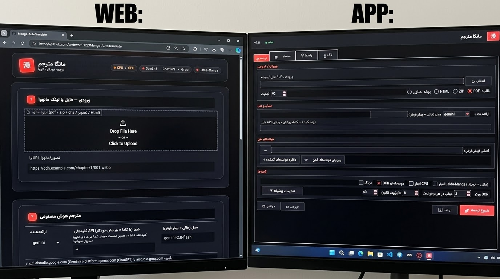
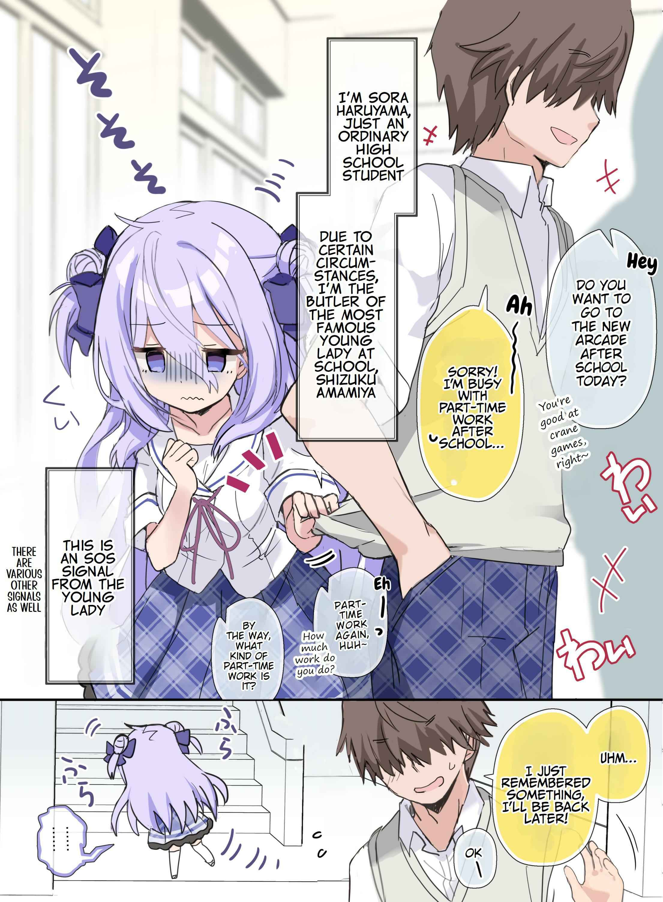
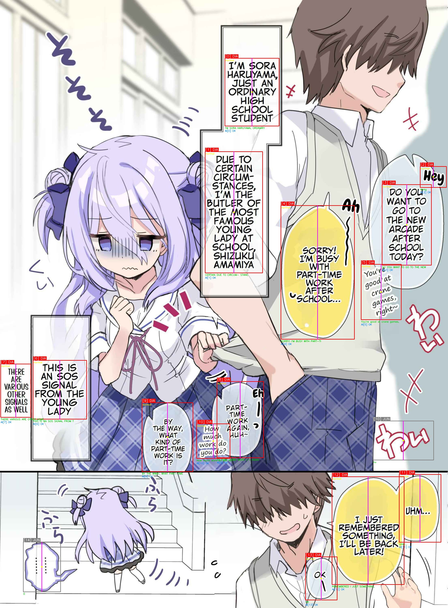
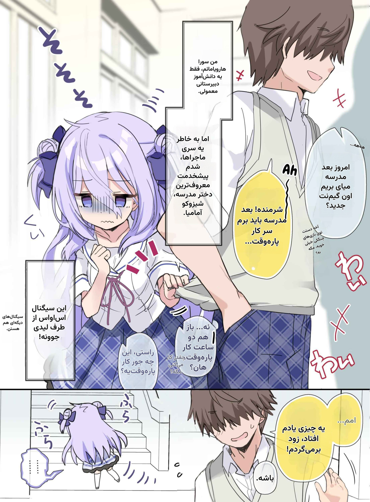

# مترجم خودکار مانگا / مانهوا (فارسی)

[](https://colab.research.google.com/github/amirwolf5122/Manga-AutoTranslate/blob/main/Manga_Translator_Colab.ipynb)
[](https://molab.marimo.io/github/amirwolf5122/Manga-AutoTranslate/blob/main/Manga-AutoTranslate.py/server)
[](https://www.python.org/downloads/)
[](LICENSE)




ابزاری برای **ترجمه خودکار صفحات مانگا و مانهوا به فارسی**.

متن را با OCR می‌خواند، فقط حروف را از داخل حباب پاک می‌کند، با مدل‌های AI ترجمه می‌کند و متن فارسی را دوباره داخل همان حباب می‌نویسد.

---

## نمونه خروجی






---

## فرآیند کار

1. ورودی: پوشه، تصویر، ZIP، PDF یا URL — چند لینک با `,` ، بازه با `1 > 14.jpg` (از اول به آخر) یا `1 < 14.jpg` (از آخر به اول) ، همه با `*.jpg`
2. صفحات کوتاه چسبانده و بلندها تکه‌تکه می‌شوند
3. تشخیص حباب با RT-DETR (حباب / متن داخل / متن آزاد)
4. OCR با PaddleOCR یا RapidOCR — انگلیسی / کره‌ای / ژاپنی / چینی
5. بازسازی فحش‌های سانسورشده
6. ترجمه — **همهٔ متن‌های فصل در یک درخواست** (استریم + پیش‌نمایش زنده)
7. پاکسازی هوشمند متن (سبکِ دو-عکسی — فقط حروف، حباب سالم)
8. رندر فارسی با فونت متناسب با لحن — متن کج و خمیده (قوسی) هم پشتیبانی می‌شود
9. خروجی: **PDF / ZIP / HTML / PSD**

---

## ویژگی‌ها

| ویژگی | توضیح |
|---|---|
| تشخیص حباب | RT-DETR-v2 ONNX — تگ چرخیده و نیمه‌شفاف |
| OCR | PaddleOCR / RapidOCR — انگلیسی / کره‌ای / ژاپنی / چینی |
| پاکسازی | خودکار: پرکردن صاف → **LaMa** (پچ‌به‌پچ) → OpenCV |
| سبک دو-عکسی | تصویر اول کامل پاک می‌شود → نواحی پاک‌شده خط‌به‌خط به تصویر دوم (خروجی) منتقل می‌شوند — روی خروجی هیچ اینپینت دیگری اجرا نمی‌شود |
| گوشه‌گردِ انتقال | گوشه‌های قطعه‌های منتقل‌شده ریز گرد + فدرِ نرم می‌شوند تا معلوم نباشد جابه‌جا شده‌اند |
| یکسانیِ خروجی | پاکسازی GPU / CPU / گوشی نتیجهٔ یکسان (پلکانِ واحدِ پچِ LaMa) |
| ضدلیمیت Gemini | پیسینگ نرخ + تشخیص سهمیهٔ روزانه + چرخش کلید/مدل |
| چند-مدلی | لیست مدل با کاما (هم Gemini هم custom) — مثال: `gemini-3.5-flash-lite,gemini-3.8-flash` + زنجیرهٔ فال‌بک خودکار |
| تشخیص مدل رایگان | دکمهٔ ↻ فقط مدل‌های **رایگانِ** زندهٔ Gemini را می‌آورد (کد خودش تشخیص می‌دهد — نه فقط «flash») |
| درخواست واحد فصل | همهٔ متن‌های فصل در یک درخواست با استریم — پیش‌نمایشِ زندهٔ «X/Y دیالوگ» |
| لنگرِ سبک | با عوض‌شدن توکن/مدل، لحنِ فصل ثابت می‌ماند — ترجمه «اول خوب، بعد کتابی» نمی‌شود |
| ضدِ فیک | پاسخ‌های جای‌نگهدار ([CENSORED] و امثالش) رد و دوباره پرسیده می‌شوند |
| ماسک فقط حروف | آستانه‌گذاری تطبیقی + فیلتر مؤلفه |
| گیتِ شاهدِ متن | جای بی‌متن هرگز اینپینت نمی‌شود (سوگندِ paddle-det) |
| دور دوم جارو | حروف جامانده (لاتین + CJK) پاک می‌شوند |
| متن چرخیده | زاویه از خطوط OCR — فقط وقتی سازگارند (شیبِ زیر ۳ درجه نویز است) |
| متن خمیده | تیترهای قوسی با قوسِ واقعی رندر می‌شوند + نگهبان‌های ضدِقوسِ کاذب |
| اندازه فونت | برابر ارتفاع واقعی خطوط اصلی (از OCR) |
| Temperature / Top-P | قابل تنظیم در وب و اندروید (پیش‌فرض ۰٫۷ / ۰٫۹) |
| سبک پرامپت | professional (پیش‌فرض) / lite — مدل‌های Lite خودکار سبکِ lite می‌گیرند؛ پرامپت قابل ویرایش |
| واترمارک | تشخیص و نادیده گرفتن + پاکسازیِ بنرِ تبلیغ (READ ON …) در حالتِ پاکسازی |
| فیلتر SFX / junk | تبلیغ و افکت صوتی ترجمه نمی‌شود (پاکسازی SFX با `--clean-sfx`) |
| پنجرهٔ سیستم | حباب‌های UI (Status/Quest/…) با براکت/دونقطه/کلیدواژه — خط‌به‌خط جدا و با فونت مخصوص؛ جعبهٔ مشخصات شخصیت همیشه خط‌به‌خط |
| برش امن دوطرفه | دو کارگر تشخیص — یکی از اول، یکی از آخر — فقط روی جای بی‌متن |
| ارائه‌دهنده‌ها | رابط: **Gemini + سرویس دلخواه (custom)** — CLI: OpenAI, DeepSeek, Groq, xAI, Together, OpenRouter, Ollama هم |
| چند کلید API | چرخش خودکار |
| کشِ مرحله‌ای | هرچی عوض شود فقط همان بخش دوباره اجرا می‌شود (استخراج / پاکسازی / ترجمه جدا کش می‌شوند) |
| ادامهٔ هوشمند | عوض‌شدن مدل/پرامپت → سؤال: «همان‌جا ادامه» یا «از اول ترجمه» |
| رندر فارسی | reshaper + bidi + فونت لحن |
| چندفصل | `*` همه / `,` چند لینک / `1 > 14.jpg` از اول به آخر / `1 < 14.jpg` از آخر به اول |
| **خروجی** | **PDF / ZIP / HTML / PSD لایه‌ای** |
| نام هوشمند | از URL یا مسیر فصل |
| Resume | ادامه از کش |
| Chunk / Stitch | کاهش مصرف API |
| دیباگ | مربع رنگی + خروجی دیباگ + دیباگِ آبیِ det (جعبه‌های خامِ تشخیص) |
| فشرده‌سازی | خروجی با کیفیتِ هوشمند (q85) — حجم کمتر بدون افت محسوس |

---

## پاکسازی دو-عکسی

قلبِ پاکسازیِ متن — خروجی هیچ‌وقت مستقیم اینپینت نمی‌شود:

1. از عکس اصلی **دو** نسخه ساخته می‌شود؛
2. نسخهٔ اول با کلِ ابزارها (پرکردن صاف → LaMa → OpenCV) **خوب پاک می‌شود**؛
3. نواحی پاک‌شده به اندازهٔ متن، **خط‌به‌خط / متن‌به‌متن** برش می‌خورند و به نسخهٔ دوم **منتقل** می‌شوند؛
4. نسخهٔ دوم = خروجی نهایی — روی آن هیچ اینپینتی اجرا نمی‌شود؛ فقط جای متن‌ها عوض شده؛
5. گوشه‌های هر قطعهٔ منتقل‌شده ریز گرد + فدرِ نرم (OpenCV) می‌شوند تا اثرِ انتقال دیده نشود.

نتیجه: هنرِ اطراف حباب، دیوارِ حباب و بافتِ صفحه در خروجی **بیت‌به‌بیت همان عکس اصلی** است — فقط داخلِ متن‌ها عوض شده.

---

## خروجی PSD

هر صفحه به‌صورت یک لایه جدا در فایل PSD ذخیره می‌شود (با `pytoshop`).

- لایه‌ها مرتب از پایین به بالا
- بوم مشترک با بزرگ‌ترین ابعاد صفحات
- اگر ابعاد > ۳۰۰۰۰px → **PSB**
- در `--debug` فایل `*_debug.psd` هم ساخته می‌شود
- نصب خودکار `pytoshop`

```bash
python manga.py -i input -o chapter.psd --font fonts/Vazirmatn-Bold.ttf --api-key KEY
python manga.py -i "URL" -o .psd --font fonts/Vazirmatn-Bold.ttf --api-key KEY
```

در رابط برنامه هم گزینه **PSD** در قالب خروجی وجود دارد.

---

## برنامه (`manga_app.py`)

محیط را تشخیص می‌دهد:

| محیط | رفتار |
|---|---|
| ویندوز / لینوکس / مک (دسکتاپ) | پنجرهٔ نیتیو (pywebview / WebView2) — دقیقاً همان رابط وب؛ تنظیمات و کلید API دائمی ذخیره می‌شود؛ «نمایش» داخل خود پنجرهٔ برنامه باز می‌شود (نه مرورگر) |
| Google Colab | رابط وب تیره + لینک عمومی gradio.live خودکار |
| Molab Marimo | رابط وب تیره + لینک عمومی gradio.live خودکار |
| GitHub Codespaces | رابط وب + لینک عمومی (بدون Port Forwarding) |
| GitHub Actions | رابط وب + لینک عمومی |

- لانچرها: `Manga.bat` / `manga.sh` → **App / Web / CLI / Exit** — خودشان هم با آپدیت برنامه به‌روز می‌شوند
- آپدیت خودکار: اول فقط فایل VERSION چک می‌شود (چند بایت) — اگر نسخهٔ جدید بود فایل‌ها موازی دانلود می‌شوند؛ هر ۳۰ دقیقه
- ذخیرهٔ تنظیمات: مرورگر وب ۳۰ دقیقه؛ پنجرهٔ دسکتاپ و اندروید دائمی؛ دکمهٔ **بکاپ (JSON)** برای جابه‌جایی تنظیمات
- **خوانندهٔ زنده**: صفحه‌ها همان‌جا که هستند در جریانِ کار پر می‌شوند؛ کلیدِ **نهایی/دیباگ**؛ **مقایسهٔ قبل/بعد**؛ زوم (نزدیک/دور/پهنا)؛ خطِ انتخابِ صفحه؛ فن‌های det / p-det / rec
- نوارهای بلندِ وبتون برای وب به برش‌های **۲۰۰۰px** خرد می‌شوند تا نمایش سریع باشد (فقط وب — خروجی کامل است)
- نوار پیشرفت زندهٔ زیر لاگ: فاز + صفحهٔ چند-از-چند + درصد (ضدِچشمک)
- **هم‌خوانِ نکو-گِرل**: کاراکترِ گربه‌ای با ۲۴ حالت — بکش و رها کن، نوازش کن، پشتِ دیوار قایم می‌شود و اگر اذیتش کنی صفحه را خاموش می‌کند!
- همهٔ متن‌های دکمه‌ها و حرف‌های کاراکتر در **یک فایل** (`manga_sections/05_ui_texts.py`) — با نوت‌پد هم قابل ویرایش است و همه‌جا (وب + اندروید) عوض می‌شود
- دیباگِ تعاملی بدون رفرش: روکشِ SVG روی عکس اصلی
- CLI تعاملی: ورودی، ارائه‌دهنده، کلید و قالب را می‌پرسد
- گارد: اگر `manga.py` فایل مترجم نباشد پیام واضح می‌دهد

```bash
python manga_app.py              # تشخیص خودکار
python manga_app.py --web        # اجبار وب
python manga_app.py --desktop    # اجبار پنجره برنامه
python manga_app.py --cli        # CLI تعاملی
python manga_app.py -- -i input -o out.psd --font fonts/Vazirmatn-Bold.ttf --api-key KEY --cpu --lama
```

---

## اپ اندروید (وضعیت در حال تست)

نسخهٔ اندروید (Chaquopy — همان موتور `manga.py` روی گوشی) هم دارد:

- دانلود APK از [Releases](https://github.com/amirwolf5122/Manga-AutoTranslate/releases/tag/android) — یا بیلد از سورس با Gradle / GitHub Actions
- راهنمای کامل نصب، بیلد و رفع مشکل: [`android/README.md`](android/README.md)
- OCR روی گوشی = PP-OCRv6 ONNX فقط رویِ کراپ‌هایِ detector-v4-s (سبکِ PC)؛ فونت‌ها و مدل‌ها بار اول خودکار دانلود می‌شوند
- خوانندهٔ گوشی: کلیدِ نهایی/دیباگ + مقایسهٔ قبل/بعد + هم‌خوانِ نکو-گِرل + دکمهٔ تلاش مجدد
- تنظیمات کامل مثلِ وب: temperature/top_p، روش پاکسازی، حالت تست و …
- سؤالِ «ادامه یا از اول ترجمه» هنگامِ عوض‌شدنِ مدل/پرامپت — مثلِ وب

---

## ارائه‌دهنده‌ها

| provider | مدل پیش‌فرض | متغیر محیطی |
|---|---|---|
| gemini | gemini-3.5-flash-lite | GEMINI_API_KEY |
| custom | — | CUSTOM_API_KEY |

**Gemini — لیست پیش‌فرض (۸ مدلِ رایگان):**

```
gemini-3.5-flash-lite, gemini-3.1-flash-lite, gemini-4-hydrogen, gemini-3.8-flash, gemini-3.7-flash, gemini-3.6-flash, gemini-3.5-flash, gemini-3-flash-preview
```

- فیلدِ مدل هر دو (Gemini و custom) **لیست با کاما** می‌پذیرد — مدل اول اصلی، بقیه فال‌بک
- دکمهٔ **↻** فقط مدل‌های **رایگانِ** زنده را از Google می‌آورد (کد خودش رایگان‌بودن را تشخیص می‌دهد)
- دکمهٔ **↗** مستقیم به صفحهٔ گرفتن توکن می‌برد (aistudio برای Gemini / سایتِ سرویسِ خودتان برای custom)
- منویِ انتخابِ AI: `auto` (خودش بین Gemini و مدل‌های ذخیره‌شدهٔ شما اولینِ در دسترس را برمی‌دارد) یا مدلِ مشخص — مدل‌های شما در مرورگر/دستگاه ذخیره می‌شوند

**سرویس دلخواه (custom)** — ۴ فرمت API خودکار از روی خودِ لینک شناخته می‌شود؛ لینک کامل endpoint را هم می‌شود چسباند:

| فرمت | نمونه لینک |
|---|---|
| OpenAI Chat Completions | `https://opencode.ai/inference/openai/v1/chat/completions` |
| OpenAI Responses API | `https://…/v1/responses` |
| Anthropic Compatible | `https://…/v1/messages` |
| Google Generative AI | `https://…/models/gemini-2.0-flash:generateContent` |

«تست کلید» خطاها را فارسیِ واضح توضیح می‌دهد — مثلاً اگر کلید اوپن‌کد سالم باشد ولی مدل «free» فقط داخل خود برنامهٔ OpenCode اجرا شود، پیام می‌دهد که باید مدل پولی یا سرویس دیگری بگذاری.

در CLI این ارائه‌دهنده‌ها هم هست: `openai` · `deepseek` · `groq` · `xai` · `together` · `openrouter` · `ollama` (نام‌های قدیمی chatgpt و grok هم پذیرفته می‌شوند).

---

## پارامترهای مهم

| پارامتر | توضیح | پیش‌فرض |
|---|---|---|
| `-i` / `--input` | ورودی | اجباری |
| `-o` / `--output` | خروجی (`.pdf` / `.zip` / `.html` / `.psd`) | اجباری |
| `--font` | فونت فارسی | اجباری |
| `--provider` | ارائه‌دهنده | gemini |
| `--api-key` | کلید API (چندتایی/کاما) | یا env |
| `--model` | مدل — **لیست با کاما = فال‌بک خودکار** | پیش‌فرض provider |
| `--ocr-lang` | زبان OCR (en/ko/ja/zh) | en |
| `--gpu` / `--cpu` | سخت‌افزار | خودکار |
| `--lama` | اجبار LaMa روی CPU (big-lama.pt) | خودکار |
| `--clean-method` | lama-manga / lama-big / opencv | lama-manga |
| `--clean-only` | فقط پاکسازی — بدون ترجمه و کلید API | — |
| `--fake-translate` | تست بدون API (متن الکی) | — |
| `--temperature` / `--top-p` | خلاقیتِ مدل | 0.7 / 0.9 |
| `--prompt-mode` | professional / lite | professional |
| `--instruction` | فایلِ دستورِ مترجم (جایگزینِ کامل) | — |
| `--active-tones` | فقط این لحن‌ها فعال بمانند | — |
| `--clean-sfx` | پاکسازی SFX و متنِ استایل‌دارِ بیرونِ حباب | خاموش |
| `--no-style-fonts` | همه با فونت اصلی رندر شوند | — |
| `--bubbles-per-request` | سقف متن در هر درخواست | 15 |
| `--batch-workers` | بستهٔ موازی | 3 |
| `--workers` | ورکر موازی OCR | 3 |
| `--det-confidence` | آستانه تشخیص | 0.16 |
| `--min-confidence` | آستانهٔ حداقلِ OCR | 0.12 |
| `--max-retries` | حداکثر تلاش (پیمایشِ زنجیرهٔ مدل‌ها) | 12 |
| `--api-timeout` | تایم‌اوت درخواست (ثانیه) | 30 |
| `--request-delay` | تأخیر بین درخواست‌ها | 0 |
| `--no-resume` | شروع دوباره | — |
| `--keep-old` | خروجی‌های قدیمی پاک نشوند | — |
| `--translate-retranslate` | عوض‌شدن مدل/پرامپت = از نو ترجمه | ادامه |
| `--stitch-max-height` | ارتفاعِ هدفِ نوارها (۰ = بدونِ برشِ مجدد) | خودکار |
| `--no-seam-repair` | خاموشیِ ترمیمِ متنِ مرزِ برش | — |
| `--img-format` | webp / png / jpg | jpg |
| `--quality` | کیفیت ۱–۱۰۰ | 90 |
| `--max-width` | سقف عرض | 0 |
| `--debug` | دیباگ | — |

فونت‌های لحن: `--font-normal` · `--font-shout` · `--font-comedy-shout` · `--font-whisper` · `--font-thought` · `--font-system` · `--font-letter` · `--font-narrator` · `--font-free` · `--font-monster` · `--font-cry` · `--font-fear` · `--font-broadcast` و ...

با `-o .psd` نام فایل از URL ساخته می‌شود.

---

## پاکسازی متن

| شرایط | روش |
|---|---|
| پس‌زمینه تخت / گرادیان | پرکردن صاف (بدون مدل) |
| بقیهٔ حباب‌ها | LaMa — پچ‌به‌پچ (پلکانِ ۲۵۶/۳۸۴/۵۱۲) |
| اگر LaMa نبود | OpenCV مؤلفه‌به‌مؤلفه (هر حفره با رنگ همسایگی خودش) |

- همهٔ مسیرها با **سبکِ دو-عکسی** به خروجی می‌رسند (بالا را ببینید)
- مدل‌های LaMa-Manga / LaMa ONNX / big-lama.pt — یکسان روی GPU و CPU
- نوارهای بسیار بلند (وبتون) باندبه‌باند پردازش و رمِ سنگین به دیسک می‌رود
- خطوط دیوار حباب از ماسک اینپنت محافظت می‌شوند (خط حباب پاک نمی‌شود)
- متنِ داخلِ حبابِ سفید/روشن با رنگِ خودِ حباب پر می‌شود — لکهٔ سیاه/خاکستری وسط حباب نمی‌ماند
- جایِ بی‌متن هرگز اینپینت نمی‌شود (گیتِ شاهدِ paddle-det)
- ماسک فقط حروف + دور دوم جارو (لاتین + CJK)

---

## استخراج متن (PaddleOCR) و GPU+CPU همزمان

| محیط | رانر | شتاب |
|---|---|---|
| اندروید (arm64) | PP-OCRv6 ONNX (رویِ کراپ‌هایِ detector-v4-s) | CPU چندنخی + سشن‌هایِ مشترک |
| PC لینوکس/ویندوز/شبیه‌ساز | ONNX Runtime | CUDA/DML/OpenVINO + CPU همزمان |

- زبان‌ها: `en` | `ko` | `ja` | `zh` (مدل مخصوص هر زبان خودکار دانلود می‌شود؛ dict از مدل خوانده می‌شود)
- استخراج: اول `detector-v4-s_int8.onnx` مکان‌های متن را پیدا می‌کند و OCR فقط روی همان کراپ‌ها اجرا می‌شود
- OCR روی CPU **۲٫۲ تا ۳٫۲ برابر سریع‌تر** از نسخه‌های قدیمی؛ ترتیبِ واژه‌های به‌هم‌ریخته ترمیم می‌شود
- زنجیرهٔ تمرکز + نجاتِ rec: نصف‌خواندنِ متن (مرگِ نصف‌متن) ریشه‌کن شده
- **dual-device** (پیش‌فرض خودکار): وقتی GPU واقعاً در دسترس باشد، پچ‌های پاکسازی و برش‌های rec بین GPU و CPU می‌چرخند → سرعت بیشتر. با `MANGA_DUAL_DEVICE=0` خاموش می‌شود. روی سیستم CPU-خالص هیچ تغییری نمی‌کند (خروجی بیت‌به‌بیت همان قبل).

---

## لیمیت رایگان Gemini

هر مدل رایگان سهمیهٔ روزانه دارد (به‌ازای هر کلید/پروژه). برنامه خودش مدیریت می‌کند:

- فاصلهٔ امن بین درخواست‌ها رعایت می‌شود تا 429 نخورد
- روی 429: اول کلید بعدی، بعد مدلِ بعدی از لیستِ شما (زنجیرهٔ فال‌بک)
- خطای «سهمیهٔ روزانه» فوراً تشخیص داده می‌شود و معطل ثانیه‌ها نمی‌ماند
- چند کلید = چند پروژه = چند برابر سهمیه
- لیستِ چند-مدلی + تشخیصِ خودکارِ مدل‌های رایگانِ جدید = سهمیهٔ بیشتر پشتِ سرِ هم

---

## شش روش اجرا
### 1) huggingface (پیشنهادی)

[](https://amirwolf512-manga-autotranslate.hf.space/)

[](https://huggingface.co/spaces/amirwolf512/Manga-AutoTranslate)

### 2) Google Colab (پیشنهادی)

[](https://colab.research.google.com/github/amirwolf5122/Manga-AutoTranslate/blob/main/Manga_Translator_Colab.ipynb)

```bash
!bash manga.sh
```

لینک عمومی `gradio.live` خودکار چاپ می‌شود. ⚠ هر دو فایل `manga.py` (مترجم) و `manga_app.py` (برنامه) باید کنار هم باشند.

### 3) molab marimo (پیشنهادی)

[](https://molab.marimo.io/github/amirwolf5122/Manga-AutoTranslate/blob/main/Manga-AutoTranslate.py/server)

```bash
bash manga.sh
```

لینک عمومی `gradio.live` خودکار چاپ می‌شود. ⚠ هر دو فایل `manga.py` (مترجم) و `manga_app.py` (برنامه) باید کنار هم باشند.

### 4) GitHub Codespaces

```bash
bash manga.sh
```

لینک عمومی خودکار می‌دهد؛ یا تب Ports → پورت 7860 → Public. برای زنده‌ماندن سرور بعد از بستن ترمینال از tmux استفاده کنید:

```bash
tmux new -s manga 'python3 manga_app.py --web'
# detach: Ctrl+B بعد D | بازگشت: tmux attach -t manga
```

### 5) GitHub Actions

ریپو را Fork کن.

از تب Actions

- **Manga Web (موقت)** — رابط وب با لینک gradio.live در لاگ؛ بعد از زمان تعیین‌شده خاموش می‌شود؛ خروجی را قبل از خاموش شدن از UI دانلود کن

Runnerهای GitHub معمولاً GPU ندارند؛ اجرا روی CPU است. وب فقط موقت است و لینک دائمی نمی‌دهد.

### 6) اجرای لوکال

```bash
git clone https://github.com/amirwolf5122/Manga-AutoTranslate.git
cd Manga-AutoTranslate

Manga.bat    # ویندوز — منو: App / Web / CLI
./manga.sh   # لینوکس / مک
```

یا مستقیم:

```bash
python manga_app.py          # تشخیص خودکار (دسکتاپ یا وب)
python manga_app.py --cli    # CLI تعاملی
python manga_app.py -- -i "https://...chapter-1/" -o out.psd --font fonts/Vazirmatn-Bold.ttf --api-key KEY --cpu
```

---

## ساختار کد

- `manga.py` — لودرِ سبک؛ بدنهٔ موتور در `manga_sections/` (۱۴ فایلِ موضوعی بهترتیبِ بارگذاری)
- `manga_app.py` — رابط وب (Gradio) + لانچر + خوانندهٔ زنده
- `android/` — اپ اندروید (Kotlin + پلِ Python)
- `manga_sections/05_ui_texts.py` — **همهٔ متن‌های رابط و حرف‌های کاراکتر در یک فایل**

---

## محدودیت‌ها

- تایتل‌های خیلی بزرگ با هاله نورانی که با نقاشی قاطی شده‌اند ممکن است کاملاً پاک نشوند.
- روی CPU، اینپینت LaMa یک بار برای کل صفحه اجرا می‌شود (برای نوارهای خیلی بلند، باندبه‌باند).
- کیفیت ترجمه به مدل و OCR بستگی دارد؛ متن خیلی استایل‌شده گاهی ناقص خوانده می‌شود.
- SFXهای هنری ممکن است دیده نشوند؛ چون ترجمه نمی‌شوند معمولاً مشکلی نیست (پاکسازیشان با `--clean-sfx`).
- واترمارک‌های نصفه‌کاره گاهی به‌اشتباه دیالوگ تشخیص داده می‌شوند.
- بعضی مدل‌های OpenAI-compatible ممکن است JSON را دقیق رعایت نکنند؛ با `--max-retries` بیشتر امتحان کنید.

---

## حمایت مالی

ヾ(•ω•`)o

**TON:** `UQBScvayaxagwTfRBhlLNaqw-sZuadlnBjSvn8OJz7XZJJzT`

**TRX:** `TMmLTaCjaW1L2xWZmpR2EBeNyCawCzEkwa`

---

## لایسنس

MIT — آزاد برای استفاده شخصی و غیرتجاری.

حقوق مانگا/مانهوا متعلق به ناشر و خالق اثر است؛ این ابزار فقط برای مطالعه شخصی است.

**توسعه‌دهنده:** [amirwolf5122](https://github.com/amirwolf5122)  
**تلگرام:** [@Amir_wolf512](https://t.me/Amir_wolf512)
