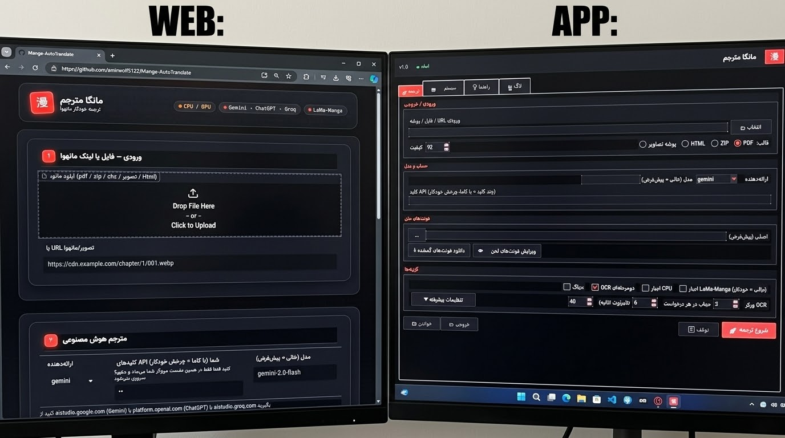
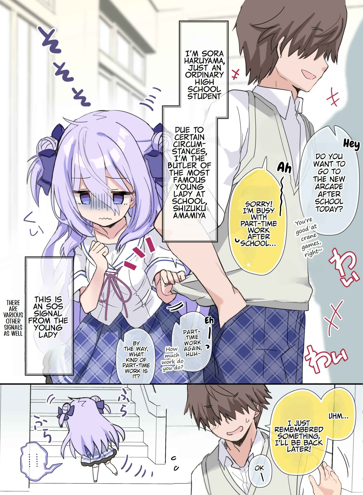
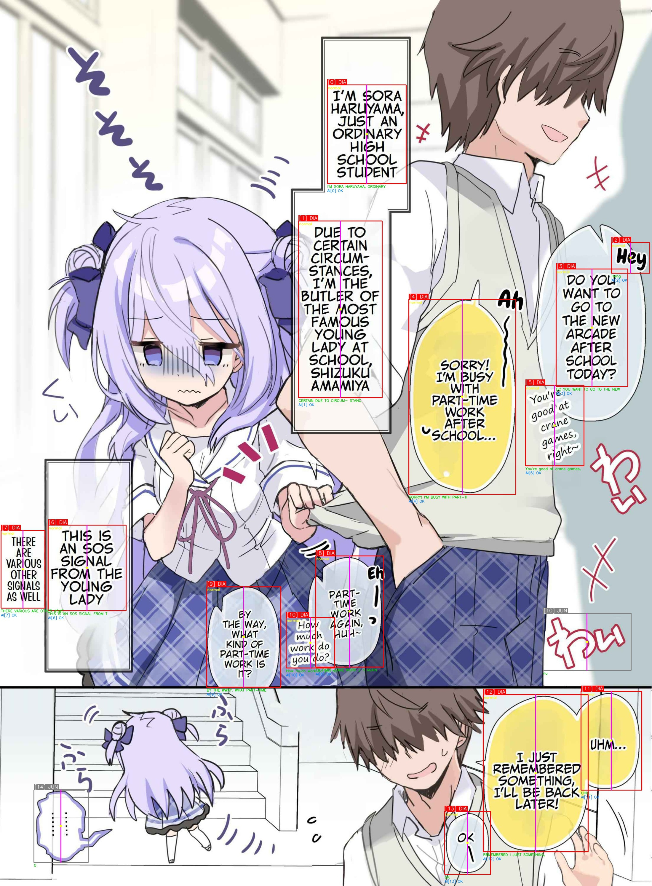
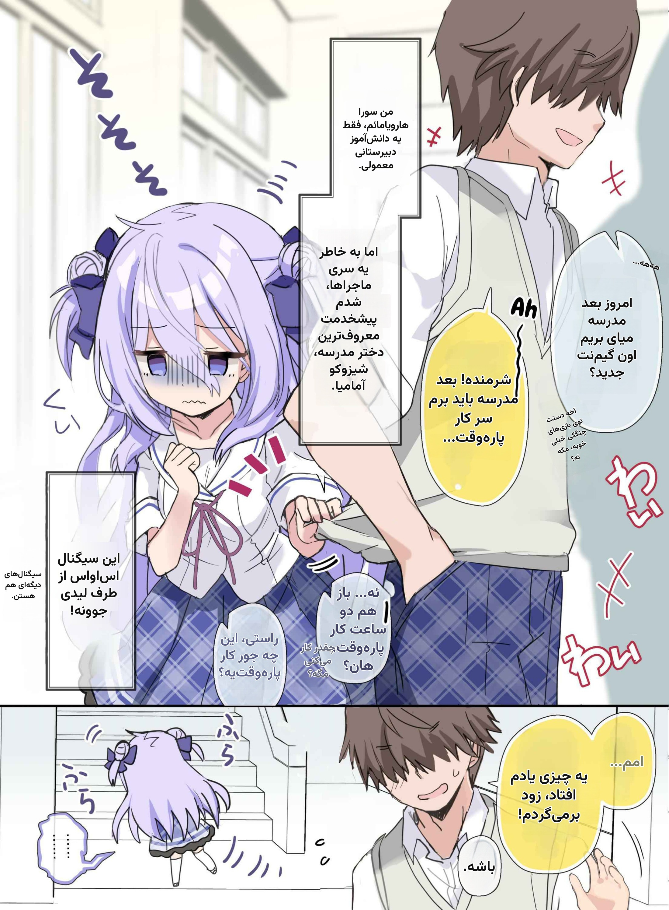

<div align="center">

# 📖 مترجم خودکار مانگا / مانهوا

[](https://colab.research.google.com/github/amirwolf5122/Manga-AutoTranslate/blob/main/Manga_Translator_Colab.ipynb)
[](https://molab.marimo.io/github/amirwolf5122/Manga-AutoTranslate/blob/main/Manga-AutoTranslate.py/server)
[](https://amirwolf512-manga-autotranslate.hf.space/)
[](https://www.python.org/downloads/)
[](https://github.com/amirwolf5122/Manga-AutoTranslate/releases/tag/apks)
[](LICENSE)



**ورودی** (پوشه / عکس / ZIP / PDF / URL) · **تشخیص حباب** RT-DETR · **OCR** Paddle/Rapid · **ترجمهٔ کل فصل در یک درخواست** · **پاکسازی دو-عکسی** · **رندر فارسی** · **خروجی:** PDF / ZIP / HTML / PSD

</div>

---

## 🖼️ نمونه خروجی

<table>
<tr><th>قبل</th><th>دیباگ</th><th>پاکسازی</th><th>بعد</th></tr>
<tr align="center">
<td></td>
<td></td>
<td></td>
<td></td>
</tr>
</table>

---

## ✨ امکانات

<table>
<tr>
<td width="50%" valign="top">

**🌐 ترجمه**

- **یک درخواست برای کل فصل** + استریم با پیش‌نمایشِ زندهٔ «X/Y دیالوگ»
- **بریف داستان** (`--brief`) — AI یک‌بار کل فصل را می‌خواند و خلاصهٔ داستان + لحن شخصیت‌ها را می‌سازد تا لحن‌ها ثابت بمانند
- **واژه‌نامهٔ اسامی** (`--glossary`) — معادل‌های قفل‌شدهٔ `English=فارسی`؛ اسم‌های جدید خودکار یادشان می‌ماند و فصل بعد خودش خوانده می‌شود
- **ضدسانسور** (`--safety-settings`) — فیلترهای گوگل BLOCK_NONE؛ خشونت و فحش با شدتِ اصلی، بدون `[CENSORED]`
- **تفکر عمیق** (پیش‌فرض روشن) — Gemini: `thinkingLevel=high` · OpenAI-سازگارها: `reasoning_effort=high`
- سبک پرامپت: `professional` / `lite` + قابل‌ویرایش کامل (`--instruction`)
- لنگرِ سبک + ضدِ فیک · Temperature / Top-P قابل تنظیم

</td>
<td width="50%" valign="top">

**🔑 مدیریت API**

- **چرخش خودکار چند کلید و چند مدل** — لیست با کاما = زنجیرهٔ فال‌بک
- **ضدلیمیت Gemini** — پیسینگِ نرخ + تشخیص سهمیهٔ روزانه + دکمهٔ ↻ برای مدل‌های **رایگانِ** زنده
- **هر سرویسی** — Gemini + custom در همهٔ رابط‌ها؛ در CLI: OpenAI، DeepSeek، Groq، xAI، Together، OpenRouter، Ollama
- **تشخیص خودکار ۴ فرمت API** از روی لینک — OpenAI Chat / Responses / Anthropic / Google

</td>
</tr>
<tr>
<td valign="top">

**🧹 پاکسازی (دو-عکسی)**

- خروجی هرگز مستقیم اینپینت نمی‌شود: نسخهٔ اول خوب پاک می‌شود → نواحی متن **خط‌به‌خط** به نسخهٔ دوم (خروجی) منتقل می‌شوند → هنر و دیوارِ حباب **بیت‌به‌بیت همان عکس اصلی** می‌ماند
- پلکانِ خودکار: پرکردنِ صاف → LaMa (پچ‌به‌پچ) → OpenCV — یکسان روی GPU / CPU / گوشی
- ماسکِ فقط-حروف · دور دومِ جارو (لاتین + CJK) · گیتِ شاهدِ متن (جای بی‌متن هرگز اینپینت نمی‌شود)

</td>
<td valign="top">

**✍️ رندر فارسی**

- فونتِ جداگانه برای هر لحن (فریاد / زمزمه / فکر / system / …)؛ اندازه از ارتفاعِ واقعی خطوطِ OCR
- متنِ چرخیده و تیترهای **خمیده (قوسی)** با قوسِ واقعی
- پنجرهٔ سیستم (Status / Quest) خط‌به‌خط با فونتِ مخصوص

</td>
</tr>
<tr>
<td colspan="2" valign="top">

**🧰 سایر**

- **کشِ مرحله‌ای** — هر چیزی عوض شود فقط همان بخش دوباره اجرا می‌شود؛ «ادامهٔ هوشمند» با عوض‌شدنِ مدل / پرامپت / بریف / واژه‌نامه
- زبان OCR: انگلیسی / کره‌ای / ژاپنی / چینی (هر ترکیب)
- ورودیِ چندفصل: `*` همه · `,` چند لینک · `1 > 14.jpg` بازه از اول · `1 < 14.jpg` از آخر
- نشانکِ «استخراج عکس» برای سایت‌های کپچادار — لینکِ همهٔ عکس‌های فصل خودکار می‌نشیند (اندروید: دکمهٔ 🌐)
- دیباگ (مربعِ رنگی + خروجی) · خوانندهٔ زنده با مقایسهٔ قبل/بعد
- همهٔ متن‌های رابط در یک فایل: `manga_sections/05_ui_texts.py`

</td>
</tr>
</table>

---

## ⚡ اجرا

| روش | لینک / دستور |
|---|---|
| 🤗 **Hugging Face** (پیشنهادی) | [amirwolf512-manga-autotranslate.hf.space](https://amirwolf512-manga-autotranslate.hf.space/) |
| 📓 **Google Colab** (پیشنهادی) | [باز کردن نوت‌بوک](https://colab.research.google.com/github/amirwolf5122/Manga-AutoTranslate/blob/main/Manga_Translator_Colab.ipynb) ← `!bash manga.sh` |
| 🌐 **Molab Marimo** (پیشنهادی) | [باز کردن](https://molab.marimo.io/github/amirwolf5122/Manga-AutoTranslate/blob/main/Manga-AutoTranslate.py/server) ← `bash manga.sh` |
| 🤖 **اندروید — کامل** | [دانلود APK](https://github.com/amirwolf5122/Manga-AutoTranslate/releases/tag/apks) (arm64 ~۸۸MB / armv7a ~۷۱MB / universal ~۱۳۷MB) — راهنما: [`android/README.md`](android/README.md) |
| ☁️ **مانگا کلود — سبک** | [Android ~۰٫۱MB · Windows x64/x86 · Linux x64/arm64/armhf](https://github.com/amirwolf5122/Manga-AutoTranslate/releases/tag/clouds) |
| 🛠 **Codespaces / Actions** | `bash manga.sh` — لینکِ عمومیِ خودکار |
| 💻 **لوکال** | پایین ⬇️ |

```bash
git clone https://github.com/amirwolf5122/Manga-AutoTranslate.git
cd Manga-AutoTranslate
Manga.bat        # ویندوز — منو: App / Web / CLI
bash manga.sh    # لینوکس / مک

# یا مستقیم:
python manga_app.py --web      # رابط وب
python manga_app.py            # پنجرهٔ دسکتاپ
python manga_app.py --cli      # CLI تعاملی
```

> محیط‌های پشتیبانی‌شده: ویندوز / لینوکس / مک (پنجرهٔ نیتیو) · Colab / Molab / Codespaces / Actions (وب + لینک عمومی) · اندروید

### 📱 کدام نسخهٔ اندروید؟

| 🌐 **مرورگر** | ☁️ **کلود** | 🏋️ **کامل** | |
|:---:|:---:|:---:|---|
| بدون نصب | ~۰٫۱ MB | ~۸۸ MB | **حجم** |
| روی سرور | روی سرور | داخل گوشی | **پردازش** |
| لازم | لازم | اختیاری | **اینترنت** |
| سریع‌ترین امتحان | گوشیِ کم‌جا | استفادهٔ همیشگی | **مناسبِ** |

<details>
<summary><b>⚙️ پارامترهای CLI — مرجع کامل</b></summary>

| پارامتر | توضیح | پیش‌فرض |
|---|---|---|
| `-i` / `-o` | ورودی / خروجی (`.pdf` `.zip` `.html` `.psd`) | اجباری |
| `--font` | فونت فارسی | اجباری |
| `--api-key` | کلید API (چندتایی با کاما = چرخش) | یا env `GEMINI_API_KEY` |
| `--model` | لیست مدل‌ها با کاما = فال‌بک خودکار | لیست رایگان Gemini |
| `--provider` | gemini / custom (+ سایر در CLI) | gemini |
| `--api-base` | دامنهٔ سرویس custom | — |
| `--ocr-lang` | en / ko / ja / zh (چندتایی) | en |
| `--brief` | بریف داستان قبل از ترجمه | خاموش |
| `--glossary` | فایل واژه‌نامه `English=فارسی` | — |
| `--safety-settings` | ضدسانسور (BLOCK_NONE) | خاموش |
| `--deep-thinking` / `--no-deep-thinking` | تفکر عمیق | روشن |
| `--max-tokens` | سقف توکن خروجی: auto/8192/16384/32768/65536/custom | auto |
| `--temperature` / `--top-p` | خلاقیت مدل | 0.7 / 0.9 |
| `--prompt-mode` | professional / lite | professional |
| `--instruction` | فایل دستور مترجم (جایگزین کامل پرامپت) | — |
| `--clean-method` | lama-manga / lama-big / opencv | lama-manga |
| `--clean-only` | فقط پاکسازی (بدون ترجمه و کلید) | — |
| `--fake-translate` | تست بدون API (متن الکی) | — |
| `--clean-sfx` | پاکسازی SFX و متن استایل‌دار بیرون حباب | خاموش |
| `--active-tones` | فقط لحن‌های مشخص فعال بمانند | — |
| `--gpu` / `--cpu` | انتخاب سخت‌افزار | خودکار |
| `--debug` | مربع رنگی + خروجی دیباگ | — |
| `--workers` / `--batch-workers` | ورکر موازی OCR / پاکسازی | 3 / 3 |
| `--max-retries` | حداکثر تلاش (پیمایش زنجیرهٔ مدل‌ها) | 8 |
| `--api-timeout` | تایم‌اوت درخواست (ثانیه) | 30 |
| `--no-resume` / `--translate-retranslate` | شروع دوباره / ترجمهٔ از نو | ادامه |

فونت‌های لحن: `--font-normal` · `--font-shout` · `--font-whisper` · `--font-thought` · `--font-system` · `--font-letter` · `--font-narrator` · `--font-free` و…

</details>

> **🔑 لیمیت رایگان Gemini:** هر مدل رایگان سهمیهٔ روزانه دارد (به‌ازای هر کلید). برنامه خودش مدیریت می‌کند — فاصلهٔ امن بین درخواست‌ها؛ روی 429 اول کلید بعدی، بعد مدل بعدی؛ خطای سهمیهٔ روزانه فوراً تشخیص داده می‌شود؛ چند کلید + لیست چند-مدلی = چند برابر سهمیه.

---

## 🗂️ ساختار کد

```
manga.py          لودرِ سبک — بدنهٔ موتور در manga_sections/ (۱۴ بخش)
manga_app.py      رابط وب (Gradio) + لانچر + خوانندهٔ زنده
manga_sections/   موتور در ۱۴ بخش — از OCR تا رندر؛ متن‌های رابط: 05_ui_texts.py
android/          اپ اندرویدِ کامل — همان موتور روی گوشی (Chaquopy)
cloud-apps/       مانگا کلود — پوسته‌های سبکِ وب‌ویو (Android / Windows / Linux)
```

موتور: تشخیص حباب (RT-DETR) + OCR (Paddle/Rapid) + ترجمه (API) + پاکسازی (LaMa/OpenCV) + رندر فارسی (reshaper + bidi)

---

## ⚠️ محدودیت‌ها

- تایتل‌های خیلی بزرگِ درهم‌با-نقاشی ممکن است کامل پاک نشوند؛ SFXهای هنری ترجمه نمی‌شوند (پاکسازی با `--clean-sfx`)
- روی CPU اینپینت LaMa کند است (نوارهای بلند باندبه‌باند)
- واترمارک‌های نصفه‌کاره گاهی به‌اشتباه دیالوگ تشخیص داده می‌شوند
- کیفیت ترجمه به مدل و OCR بستگی دارد؛ مدل‌های JSON-ناسازگار با `--max-retries` بیشتر امتحان شوند

---

## ☕ حمایت مالی

<div align="center">

ヾ(•ω•`)o

| 💎 **TON** | `UQBScvayaxagwTfRBhlLNaqw-sZuadlnBjSvn8OJz7XZJJzT` |
|:---:|:---|
| 🪙 **TRX** | `TMmLTaCjaW1L2xWZmpR2EBeNyCawCzEkwa` |

</div>

---

<div align="center">

**MIT** — آزاد برای استفادهٔ شخصی و غیرتجاری · حقوقِ مانگا/مانهوا متعلق به ناشر و خالقِ اثر است؛ این ابزار فقط برای مطالعهٔ شخصی است.

**توسعه‌دهنده:** [amirwolf5122](https://github.com/amirwolf5122) · **تلگرام:** [@Amir_wolf512](https://t.me/Amir_wolf512)

</div>
